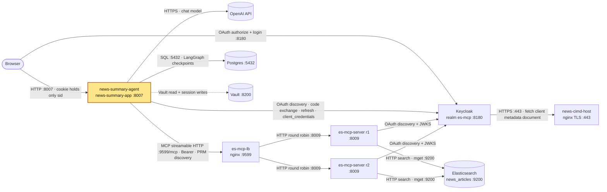

# news-summary-agent

## Purpose

FastAPI service (container `news-summary-app`, port 8007) that takes a natural-language
news question and returns a grounded, cited summary plus the source articles. It is the
user-facing query layer of the news pipeline. It does not talk to Elasticsearch: articles
come from es-mcp-server's MCP tools, and the summary comes from an OpenAI chat model.

The pipeline is a fixed LangGraph **workflow** (not an agent) in `src/graph/build_graph.py`:

1. **classify** (`src/nodes/classification.py`): the LLM returns `is_news_query`,
   `categories`, `fetch_latest`. For news queries it calls the MCP tool `category_search`
   to count matching articles. This check is advisory: errors are logged and the workflow continues.
2. Guard rail 1: if the query is not news, `reply_off_topic` returns a canned reply (no search, no LLM summary).
3. **search** (`src/nodes/search.py`): calls the MCP tool `article_search` with
   `{"user_query": {query, categories, fetch_latest}}` and gets article refs (id + score). es-mcp-server
   runs the query; with `fetch_latest` it keeps the last 7 days, newest first.
4. Guard rail 2: if no refs come back, `reply_no_results` returns a canned reply (no LLM call).
5. **summarize** (`src/nodes/summary.py`): calls the MCP tool `mget` with the ids, caps each
   article's content at `SUMMARY_CONTENT_MAX_CHARS` (1000; es-mcp-server also truncates to 1000)
   and asks the LLM for a 3-5 paragraph summary that cites article titles in brackets and uses only those articles.

Runtime details:

- Async end to end: `async /query` → `graph.ainvoke` → async nodes → `AsyncPostgresSaver`
  on a psycopg `AsyncConnectionPool` (`src/adapters/postgres.py`). Each request gets a fresh
  `uuid4` `thread_id` (recursion limit 10), so runs never share checkpoints.
- The lifespan (`src/adapters/lifespan.py`) opens the Postgres pool and builds the chat model
  and the MCP client **without connecting it**. `LazyMcpSession` (`src/adapters/mcp_session.py`)
  connects on the first tool call and reuses that connection, so each later tool call is a single
  `tools/call` request. The app starts while es-mcp-server or Keycloak are down (a failed connect
  is retried on the next call), and the kept connection survives es-mcp-server restarts because
  MCP 2026-07-28 is sessionless. The protocol version is pinned (`MCP_PROTOCOL_VERSION`), so
  connecting skips the `server/discover` probe.
- MCP calls authenticate as a service account: `ServiceAccountTokenProvider` gets a
  `client_credentials` token from Keycloak (client `news-summary-app-svc`). The token is cached
  and fetched again when it is within `SERVICE_TOKEN_LEEWAY_SEC` of expiry. `ServiceTokenAuth`
  (an httpx2 `Auth`) adds the Bearer header and, on a 401, fetches a new token and retries once.
  Every MCP call uses this service account, so es-mcp-server never sees the user's identity;
  the user's login only gates access to the app.
- The Keycloak token endpoint comes from `AuthServerMetadata`, which is loaded lazily, fetched
  once and then reused. First the issuer is discovered from es-mcp-server's protected-resource
  metadata (RFC 9728): `resource` must equal `MCP_URL` and `authorization_servers[0]` must
  equal `ALLOWED_ISSUER_URL`. Then the OIDC metadata is fetched, and its `issuer` must match.
- Users log in through a BFF flow (`src/auth/`):
  - Keycloak realm `es-mcp`, public CIMD client
    `https://news-cimd-host/clients/news-summary-app-cimd.json`, authorization code + PKCE S256,
    `resource=MCP_URL`.
  - The callback checks `iss` (RFC 9207).
  - Tokens stay on the server. The signed cookie `nsa_session` holds only `sid`. Access tokens
    live in memory. Refresh tokens are stored in Vault at
    `secret/NEWS-SUMMARY-APP/SESSIONS/<sid>` (keys `refresh_token`, `sub`).
  - Token refresh and session rebuild (in `AuthGuard`): if Keycloak or Vault is down, the app
    returns 503 with `Retry-After: 30` and keeps the session. If Keycloak rejects the refresh
    (`invalid_grant`), the user is logged out. After an app restart the first refresh also needs
    `AuthServerMetadata`, so es-mcp-lb (issuer discovery) must be reachable too.
  - At `/auth/callback`: if the session store (Vault) fails, the browser is redirected to
    `/login?error=auth_unavailable`; a token response without a refresh token redirects to
    `/login?error=login_failed`.
  - Session-store sweeper (`_sweep_sessions` in `src/adapters/lifespan.py`,
    `VaultRefreshTokenStore.sweep`): at start-up and then every `SESSION_SWEEP_INTERVAL_SEC`
    (86400) it deletes stored sessions not updated for longer than `SESSION_STORE_MAX_AGE_SEC`
    (39600, above Keycloak's 10 h SSO session max). Entries otherwise pile up when a cookie just
    expires. A failed sweep is logged and retried at the next interval.
  - There is no logout endpoint yet (planned together with user management / Redis).
- `AuthGuard` denies by default. Public paths: `/login`, `/auth/login`, `/auth/callback`, `/health`.
  Without a session, page requests are redirected (302) to `/login`. Other requests get
  401 `{"error": "login_required"}`. Protected responses carry `Cache-Control: no-store`.
- Errors reaching the client are fixed text only. Exception details are logged, never returned.

| Situation | Client sees |
|---|---|
| `article_search` fails (transport or tool error) | HTTP **503** + `Retry-After: 30`, `QueryFailedResponse`, `error` = `Search is unavailable at this time, please try again in a few seconds` |
| `mget` fails (transport or tool error, including none of the ids found) | HTTP 200, `status: "ok"`, `summary` = the same "Search is unavailable..." text, `articles: []` |
| `category_search` fails (classify) | Ignored: logged, count 0, the workflow continues |
| Summary LLM call fails | HTTP 200, `status: "ok"`, `summary` = `Unable to summarise the articles at this time` |
| Classify LLM call fails, or any other exception | HTTP **500**, `QueryFailedResponse`, `error` = `Unable to process the query at this time, please try again later` |

### Endpoints (`src/api/app.py`)

| Method | Path | Auth | Description |
|---|---|---|---|
| `POST` | `/query` | session | Runs the workflow for one query |
| `GET` | `/chat` | session | Chat UI (`static/chat-ui.html`). Posts to `/query` and redirects to `/login?error=session_expired` when the session has ended |
| `GET` | `/login` | public | Login page (`static/login.html`). Shows fixed text for `?error=access_denied, session_expired, state_mismatch, login_failed, auth_unavailable` |
| `GET` | `/auth/login` | public | 302 to the Keycloak authorize endpoint |
| `GET` | `/auth/callback` | public | Code exchange, creates the session, 302 to `/chat` |
| `GET` | `/health` | public | `{"status": "ok"}` |
| `GET` | `/static/*`, `/docs`, `/redoc`, `/openapi.json` | session | Static files, OpenAPI UIs and schema |

`POST /query` request:

```json
{ "query": "What are the latest developments in AI regulation?" }
```

Success (`status: "ok"`):

```json
{
  "query": "What are the latest developments in AI regulation?",
  "categories": ["technology", "ai", "politics"],
  "summary": "Regulators across the EU and US are accelerating AI oversight...",
  "articles": [
    {
      "title": "EU AI Act Enters Final Phase",
      "link": "https://eurotech.example.com/eu-ai-act",
      "source": "EuroTech",
      "published_at": "2026-03-28"
    }
  ],
  "duration_seconds": 2.341,
  "status": "ok"
}
```

Failure (`status: "failed"`). The HTTP status equals `error_code`: **503** with `Retry-After: 30`
when search (es-mcp-server) is unavailable, **500** for anything else. `error` is always fixed
text; exception details stay in the server log.

```json
{
  "query": "...",
  "error": "Search is unavailable at this time, please try again in a few seconds",
  "error_code": 503,
  "status": "failed"
}
```

## Where it fits



The app sits between the browser and the MCP tier. It logs users in with Keycloak,
searches through es-mcp-lb, and stores LangGraph checkpoints in Postgres and login
sessions in Vault. Full system diagram: [docker_services architecture](../docker_services/README.md#architecture).

## Depends on / Depended on by

What it calls:

| Service | Protocol / port | Why |
|---|---|---|
| es-mcp-lb → es-mcp-server | MCP streamable HTTP, `http://es-mcp-lb:9599/mcp`, Bearer service token | Tools `category_search` (classify), `article_search` (search), `mget` (summary) |
| es-mcp-lb → es-mcp-server | HTTP GET `:9599/.well-known/oauth-protected-resource/mcp` | Discover and check the issuer (RFC 9728) |
| Keycloak | HTTP `:8180`, realm `es-mcp` | OIDC metadata, user code exchange + refresh (CIMD public client), `client_credentials` for `news-summary-app-svc` |
| news-cimd-host | (called by Keycloak, not the app) HTTPS `:443` | Hosts this app's client metadata document |
| Postgres | SQL `:5432` | `AsyncPostgresSaver` checkpoints (`saver.setup()` runs at startup) |
| OpenAI API | HTTPS | Chat model `openai:gpt-4o-mini` (classify + summarize) |
| Vault | HTTP `:8200` (`hvac`) | Startup secret load; read/write/delete session refresh tokens; list + metadata reads for the session sweep |

Who calls it:

| Caller | How |
|---|---|
| Browser (user) | `http://news-summary-app:8007` (`/chat`, `/query`, `/login`, `/auth/*`); Keycloak redirects the browser back to `/auth/callback` |
| Docker healthcheck | `GET http://news-summary-app:8007/health` every 60 s |

## Config & secrets

Bootstrap env vars (set outside the app; see `docker-compose.yml`):

| Var | Value in compose | Purpose |
|---|---|---|
| `VAULT_ADDR` | `http://vault-server:8200` | Vault address |
| `VAULT_TOKEN` | `${VAULT_TOKEN}` from your shell | Vault token (startup load + session store) |
| `VAULT_SECRET_PATH` | `secret/CREDENTIALS,secret/NEWS-SUMMARY-APP/CONFIG` | Comma-separated KV v2 paths (mount `secret`) |
| `PYTHONPATH` | `src` | Import root |

Vault (KV v2, mount `secret/`, key names only). `load_secrets()` (`src/config/vault_secrets.py`)
copies **every** key at each `VAULT_SECRET_PATH` path into `os.environ`, not only the ones this app uses.

| Path | Keys used | Used by |
|---|---|---|
| `secret/CREDENTIALS` | `POSTGRES_DB`, `POSTGRES_USER`, `POSTGRES_PASSWORD` | Postgres pool |
| | `OPENAI_API_KEY` | Read from env by the OpenAI client (LangChain) |
| `secret/NEWS-SUMMARY-APP/CONFIG` | `SERVICE_CLIENT_SECRET` | `client_credentials` for `news-summary-app-svc` |
| | `NEWS_APP_SESSION_SECRET` | Signs the `nsa_session` cookie; at least 32 characters |
| `secret/NEWS-SUMMARY-APP/SESSIONS/<sid>` | `refresh_token`, `sub` | Written and read by the app (one entry per login session); expired entries deleted by the sweeper |

`src/resources/application-config.yaml`:

| Key | Value | Purpose |
|---|---|---|
| `PG_HOST` | `postgres` | Postgres host (same name in Docker and locally via `/etc/hosts`) |
| `PG_PORT` | `5432` | Postgres port |
| `PG_POOL_MIN_SIZE` | `1` | Async pool min connections |
| `PG_POOL_MAX_SIZE` | `10` | Async pool max connections |
| `LLM_MODEL` | `openai:gpt-4o-mini` | LangChain `provider:model` for `init_chat_model` |
| `LLM_TEMPERATURE` | `0.0` | Sampling temperature |
| `LLM_TIMEOUT_SEC` | `10` | LLM request timeout |
| `SUMMARY_CONTENT_MAX_CHARS` | `1000` | Per-article content cap in the summary prompt |
| `MCP_URL` | `http://es-mcp-lb:9599/mcp` | MCP endpoint; also the OAuth `resource` / token audience |
| `MCP_PROTOCOL_VERSION` | `2026-07-28` | MCP protocol version es-mcp-server speaks; pinned so connecting skips the version probe |
| `ALLOWED_ISSUER_URL` | `http://keycloak:8180/realms/es-mcp` | The only issuer accepted from discovery |
| `BFF_BASE_URL` | `http://news-summary-app:8007` | Base for redirect URI (`/auth/callback`) |
| `MCP_WELL_KNOWN_URI` | `/.well-known/oauth-protected-resource` | Protected-resource metadata prefix (RFC 9728) |
| `CIMD_CLIENT_ID` | `https://news-cimd-host/clients/news-summary-app-cimd.json` | Public client id for user login |
| `SESSION_MAX_AGE_SEC` | `36000` | Cookie max age (optional; default 36000; keep at or below the Keycloak SSO Session Max) |
| `AS_WELL_KNOWN_URL` | `/.well-known/openid-configuration` | OIDC metadata path appended to the issuer |
| `APP_VAULT_SESSIONS_PATH` | `NEWS-SUMMARY-APP/SESSIONS` | Vault path (under `secret/`) for session refresh tokens |
| `SESSION_STORE_MAX_AGE_SEC` | `39600` | Stored sessions not updated for longer than this are deleted by the sweeper (keep above the Keycloak SSO Session Max) |
| `SESSION_SWEEP_INTERVAL_SEC` | `86400` | Seconds between session-store sweeps (first sweep at start-up) |
| `SERVICE_CLIENT_ID` | `news-summary-app-svc` | Service-account client id for MCP calls |
| `SERVICE_TOKEN_LEEWAY_SEC` | `60` | Refetch the service token this many seconds before expiry |

Logging: `src/resources/logging_config.json` logs to the console and to `/app/logs/news-summary-agent.log` (`TimedRotatingFileHandler`: rotated daily at midnight UTC, 14 days kept)
(compose mounts `../logs`). If that file cannot be opened (for example in a local run without
`/app/logs`), the app falls back to `basicConfig(INFO)` and logs the error.

**Logs:** two copies. (1) The log file `~/github/logs/news-summary-agent.log` — the container's `/app/logs`, bind-mounted from `../logs` — rotated daily at midnight UTC with 14 days kept (`<name>.log.YYYY-MM-DD`). (2) The console output, which Docker keeps for `news-summary-app` (`docker logs <container>`), rotated at 3 × 10 MB per container with the oldest file deleted automatically (`logging:` in `docker-compose.yml`). The docker_services log-collector deliberately skips this container, because the log file already exists; see `docker_services/README.md` (Logs).

## Run locally

Prerequisites: to **start**, the app needs vault-server (unsealed) and postgres on
`services_network` / `vault-network`. To **serve** logins and queries it also needs keycloak,
news-cimd-host, es-mcp-lb and es-mcp-server; they can come up before or after the app. Host
names resolve through `/etc/hosts` to `127.0.0.1`.

Docker (normal path):

```bash
export VAULT_TOKEN=...            # never commit it
docker compose up -d --build      # service `app`, container news-summary-app
docker compose logs -f app
```

The image runs `python -m uvicorn api.app:app --host 0.0.0.0 --port 8007 --log-level info`.

Without Docker:

```bash
uv sync
export VAULT_ADDR=http://vault-server:8200 VAULT_TOKEN=... \
       VAULT_SECRET_PATH=secret/CREDENTIALS,secret/NEWS-SUMMARY-APP/CONFIG
PYTHONPATH=src uv run uvicorn api.app:app --port 8007
# or: PYTHONPATH=src uv run python src/main.py   (binds 0.0.0.0:8007)
```

Open `http://news-summary-app:8007/chat`. Use that host name, not `localhost`, because
`BFF_BASE_URL` and the Keycloak redirect URI use it, and the session cookie is set for it.

Startup order (from `src/api/app.py` and the lifespan): load Vault secrets → load YAML →
build `BffConfig` (checks `NEWS_APP_SESSION_SECRET`) → connect to the Vault session store →
lifespan: open the Postgres pool, run `saver.setup()` and start the session-store sweeper. Only Vault and Postgres are hard
start-up dependencies. Issuer discovery and the service token happen on first use (first login,
first MCP call) and are retried on the next request if they fail.

## Test

```bash
uv run pytest                                   # 150 tests (pytest.ini: pythonpath=src, *_test.py)
uv run pytest --cov=src --cov-report=term       # 99.90% total (measured); fail_under = 90 ([tool.coverage.report])
uv run mypy --strict src
uv run ruff check src tests                     # "All checks passed!"
```

- Ruff uses its default rule set for the pinned `ruff==0.16.8` (no rule selection in
  `[tool.ruff]`, `pyproject.toml`). Ruff is not run in CI.

- Async tests use anyio's pytest plugin (`pytestmark = pytest.mark.anyio`).
- No live services are needed:
  - `tests/fake_mcp.py`: an in-memory fastmcp server with the same tools as es-mcp-server, reached through `fastmcp.Client(server)`.
  - `tests/auth/fake_keycloak.py`: a fake Keycloak over `httpx2.MockTransport`.
  - In-memory session stores, `InMemorySaver` for checkpoints, and a fake LLM.

## Ports

| Container | Container port | Host port | Host bind |
|---|---|---|---|
| news-summary-app | 8007 | 8007 | `127.0.0.1` (compose `"127.0.0.1:8007:8007"`) |

## Troubleshooting

| Symptom | Cause | Fix |
|---|---|---|
| `ValueError: VAULT_ADDR and VAULT_TOKEN must be set` at startup | Bootstrap env missing | Export `VAULT_TOKEN` before `docker compose up`; set `VAULT_ADDR`, `VAULT_SECRET_PATH` for local runs |
| `ValueError: VAULT_SECRET_PATH must be set.` at startup | `VAULT_SECRET_PATH` missing or empty | Set it to `secret/CREDENTIALS,secret/NEWS-SUMMARY-APP/CONFIG` (compose sets it; export it for local runs) |
| `ValueError: Exception while reading secrets from vault ...` / `Vault authentication failed` | Vault sealed or down, bad token, or a missing path in `VAULT_SECRET_PATH` | Unseal Vault, check the token, check that both paths exist |
| `ValueError: NEWS_APP_SESSION_SECRET must be set ... at least 32 characters` | Key missing or too short in `secret/NEWS-SUMMARY-APP/CONFIG` | Store a value of at least 32 characters (e.g. `openssl rand -base64 48`) |
| `KeyError: 'SERVICE_CLIENT_SECRET'` / `'POSTGRES_DB'` at startup | Key missing in Vault | Add the key at the path in the table above |
| Queries return "Search is unavailable"; logs show `ServiceTokenUnavailable` | Keycloak unreachable, or a wrong `SERVICE_CLIENT_SECRET` / client `news-summary-app-svc` | Start Keycloak; check the client and secret |
| Login or queries fail: `configured mcp_url ... does not match` or `configured allowed issuer ... does not match` | es-mcp-server's protected-resource metadata disagrees with `MCP_URL` / `ALLOWED_ISSUER_URL` | Make the YAML values and es-mcp-server's config agree |
| `MCP server issuer ... is not same as issuer from AS ...` or `AS metadata is missing ...` | Keycloak's OIDC `issuer` differs from the discovered one (e.g. wrong hostname) or metadata is incomplete | Check Keycloak's hostname setting so `issuer` = `http://keycloak:8180/realms/es-mcp` |
| Startup fails connecting to Postgres | Postgres down or bad `POSTGRES_*` | Start Postgres; check the credentials |
| Answer: "Search is unavailable at this time, please try again in a few seconds" | `article_search` failed (HTTP 503), or `mget` failed (HTTP 200): es-mcp-lb/server down, ES down, a tool error, or none of the article ids found by `mget` (es-mcp-server returns a `ToolError`) | Check es-mcp-lb and es-mcp-server logs; retry |
| MCP calls return 401 repeatedly | es-mcp-server rejects the service token even after the one forced refetch + retry. Likely audience/issuer (UNVERIFIED: depends on es-mcp-server's token checks) | Check that the service-account token's audience includes `MCP_URL` and the issuer matches; check es-mcp-server logs |
| Answer: "Unable to summarise the articles at this time" (HTTP 200) | The summary LLM call failed or timed out (`LLM_TIMEOUT_SEC=10`) | Check `OPENAI_API_KEY` and network access to OpenAI |
| HTTP 500 "Unable to process the query at this time, please try again later" | The classify LLM call failed (OpenAI down, timeout, bad `OPENAI_API_KEY`), or another unexpected exception in the workflow | See the app logs (full traceback is logged); check `OPENAI_API_KEY` and network access to OpenAI |
| 503 `{"error": "auth_unavailable"}` or "temporarily unavailable" page, `Retry-After: 30` | Keycloak or Vault did not answer during a token refresh or a session rebuild (after a restart, also es-mcp-lb discovery); the session is kept | Bring Keycloak/Vault (and es-mcp-lb) back and retry |
| `/login?error=auth_unavailable` | At `/auth/callback` the session could not be stored (Vault down) | Bring Vault back and log in again; logs show `callback could not store the session` |
| 401 `{"error": "login_required"}` / redirect to `/login` | No session, or the refresh was rejected (`invalid_grant`: SSO session expired or revoked) | Log in again |
| `/login?error=login_failed` | Discovery/metadata failure at `/auth/login`, callback `iss` mismatch, token exchange failed, or the token response had no refresh token | Check app logs (`login could not start`, `callback iss mismatch`, `callback failed`, `token response has no refresh token`) |
| `/login?error=state_mismatch` | Cookie lost between login and callback (e.g. opened via `localhost` instead of `news-summary-app`) | Use `http://news-summary-app:8007` |
| Healthcheck unhealthy | App did not finish startup (see the startup rows above) | `docker compose logs app` |
